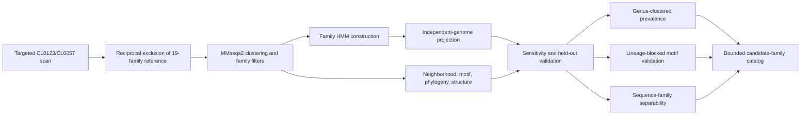

# Analysis workflow



The workflow terminates in a computational catalog, not an experimentally confirmed regulome. Figure S10 provides a submission-ready raster version of the core workflow; Figures S11--S13 report the three extended validations.

Run the complete released analysis with:

```bash
python -m archaeal_dbd.cli all --output-dir results/generated
```

The command regenerates the original audit and sensitivity outputs together with the lineage-stratified catalog accumulation curve, genus-clustered prevalence bootstrap, sequence-family separability analysis, and lineage-blocked motif validation. `scripts/preflight_extended_validation.py --strict` is a deliberate input gate for the analyses that cannot be run from the deposited material; it fails rather than substituting or inventing missing data.

The complete catalog-member sequence archive can be independently refreshed from NCBI with `python scripts/recover_catalog_sequences.py`. This networked provenance step is intentionally separate from `make all`; its output is covered by the manifest and release tests.
